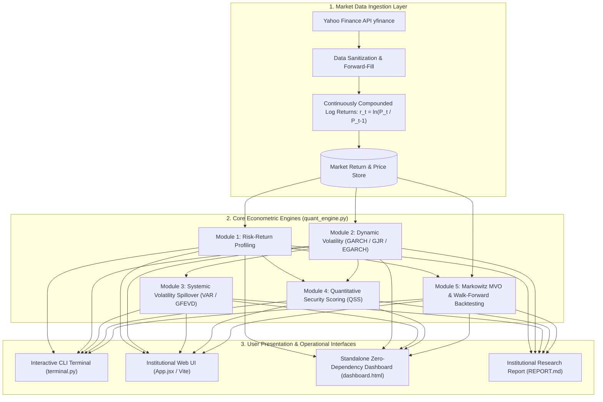
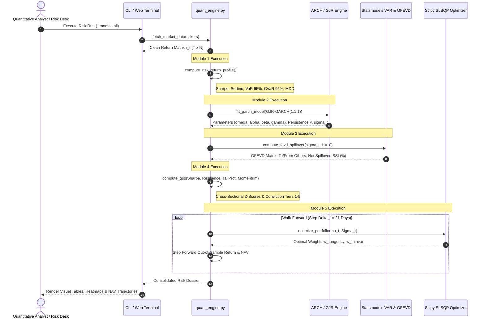

# Antigravity Quantitative Risk Terminal — Technical Architecture

This document details the end-to-end architecture, mathematical workflows, component interfaces, and deployment topologies of the **Antigravity Quantitative Risk Terminal & Econometrics Engine**.

---

## 1. High-Level System Architecture



---

## 2. Pipeline Execution Sequence



---

## 3. Detailed Module Specifications

### Module 1: Empirical Risk-Return Profiling
- **Input**: Matrix of adjusted close prices $P \in \mathbb{R}^{T \times N}$.
- **Transform**: $r_{i,t} = \ln(P_{i,t} / P_{i,t-1})$.
- **Metrics**:
  - Annualized Return: $\mu_{\text{ann}, i} = 252 \times \bar{r}_i$
  - Annualized Volatility: $\sigma_{\text{ann}, i} = \sqrt{252} \times s_i$
  - Sharpe Ratio: $\frac{\mu_{\text{ann}, i} - r_f}{\sigma_{\text{ann}, i}}$
  - Downside Semi-Deviation: $\sigma_{\text{down}, i} = \sqrt{\frac{252}{T} \sum \min(r_{i,t} - \tau, 0)^2}$
  - Sortino Ratio: $\frac{\mu_{\text{ann}, i} - r_f}{\sigma_{\text{down}, i}}$
  - Parametric 95% 1-Day VaR: $1.64485 \sigma_{d, i} - \mu_{d, i}$
  - Historical 95% 1-Day VaR: $-q_{0.05}(r_i)$
  - 95% Conditional VaR: $-\frac{1}{|K_i|} \sum_{t \in K_i} r_{i,t}, \quad K_i = \{t \mid r_{i,t} \le - \text{VaR}_{0.95}^{\text{hist}}\}$

### Module 2: Dynamic Volatility Forecasting Framework
- **Models**:
  1. Standard GARCH(1,1): $\sigma_t^2 = \omega + \alpha \epsilon_{t-1}^2 + \beta \sigma_{t-1}^2$
  2. GJR-GARCH(1,1,1): $\sigma_t^2 = \omega + (\alpha + \gamma I_{t-1}) \epsilon_{t-1}^2 + \beta \sigma_{t-1}^2$
  3. EGARCH(1,1): $\ln(\sigma_t^2) = \omega + \alpha (|\frac{\epsilon_{t-1}}{\sigma_{t-1}}| - \sqrt{\frac{2}{\pi}}) + \gamma \frac{\epsilon_{t-1}}{\sigma_{t-1}} + \beta \ln(\sigma_{t-1}^2)$
- **Persistence & Shock Half-Life**:
  - GJR Persistence: $P = \alpha + \beta + \frac{\gamma}{2}$
  - Shock Half-Life: $T_{1/2} = \frac{\ln(0.5)}{\ln(P)}$

### Module 3: Systemic Volatility Spillover (Diebold-Yilmaz 2012)
- **VAR Representation**: $Y_t = \sum_{k=1}^p \Phi_k Y_{t-k} + \varepsilon_t, \quad \varepsilon_t \sim \mathcal{N}(0, \Sigma)$.
- **Generalized FEVD**:
  $$\theta_{ij}(H) = \frac{\sigma_{jj}^{-1} \sum_{h=0}^{H-1} (e_i' A_h \Sigma e_j)^2}{\sum_{h=0}^{H-1} (e_i' A_h \Sigma A_h' e_i)}$$
- **Row Normalization**: $\tilde{\theta}_{ij}(H) = \frac{\theta_{ij}(H)}{\sum_{k=1}^N \theta_{ik}(H)} \times 100$.
- **Directional Indices**:
  - From Others: $\mathcal{S}_{i \leftarrow \bullet} = \sum_{j \neq i} \tilde{\theta}_{ij}$
  - To Others: $\mathcal{S}_{\bullet \leftarrow i} = \sum_{j \neq i} \tilde{\theta}_{ji}$
  - Net Spillover: $\mathcal{S}_i^{\text{net}} = \mathcal{S}_{\bullet \leftarrow i} - \mathcal{S}_{i \leftarrow \bullet}$
  - Total Systemic Spillover Index: $\text{SSI} = \frac{1}{N} \sum_{i=1}^N \mathcal{S}_{i \leftarrow \bullet}$

### Module 4: Quantitative Security Scoring (QSS)
- **Cross-Sectional Standardization**:
  $$Z_k(i) = \frac{F_k(i) - \bar{F}_k}{\sigma_{F_k}}$$
- **Factor Vector**:
  $$\text{QSS}_i = 0.35 Z(\text{Sharpe}) + 0.20 Z(1 - P) + 0.25 Z(-\text{CVaR}_{0.95}) + 0.20 Z(\text{Momentum})$$
- **Conviction Tiers**: Tier 1 (Top 20%) to Tier 5 (Bottom 20%).

### Module 5: Markowitz Optimization (MVO) & Walk-Forward Backtesting
- **Tangency Portfolio**:
  $$\max_w \frac{w' \mu_{\text{ann}} - r_f}{\sqrt{w' \Sigma_{\text{ann}} w}} \quad \text{s.t.} \quad \sum w_i = 1, \quad w_i \ge 0$$
- **Minimum Variance Portfolio**:
  $$\min_w w' \Sigma_{\text{ann}} w \quad \text{s.t.} \quad \sum w_i = 1, \quad w_i \ge 0$$
- **Walk-Forward Rolling Loop**:
  - In-sample estimation window: $L = 252$ trading days.
  - Rebalance step: $\Delta t = 21$ trading days.
  - Generates out-of-sample portfolio return series $R_{p, t}$ and cumulative NAV curves.

---

## 4. Software Component & File Structure

```
antigravity-quant-risk-terminal/
├── quant_engine.py          # Core Econometric Engine & Vectorized Solvers
├── terminal.py              # CLI Terminal with colorized tables & arg parsing
├── App.jsx                  # React 18 Web Terminal Component
├── dashboard.html           # Standalone Single-File Zero-Dependency HTML5 Dashboard
├── index.html               # Vite HTML Shell
├── main.jsx                 # Vite Entrypoint
├── package.json             # Frontend Dependencies & Scripts
├── test_quant_engine.py     # Unit Tests (100% Pass Rate across 6 test suites)
├── requirements.txt         # Python Package Requirements
├── README.md                # Mathematical Formulations & Quickstart Guide
├── REPORT.md                # Institutional Quantitative Empirical Research Report
└── ARCHITECTURE.md          # Technical Architecture, Data Flows & Mermaid Diagrams
```

---

## 5. Deployment Topologies

1. **Local Quantitative Workstation (Python CLI)**:
   ```bash
   pip install -r requirements.txt
   python terminal.py --module all
   ```
2. **Interactive Zero-Install Dashboard**:
   Double click [`dashboard.html`](file:///d:/Project/antigravity-quant-risk-terminal/dashboard.html) in any modern browser.
3. **Institutional React Web Terminal (Vite Dev Server)**:
   ```bash
   npm install
   npm run dev
   ```
4. **Automated CI/CD Test Pipeline**:
   ```bash
   python -m unittest test_quant_engine.py -v
   ```
